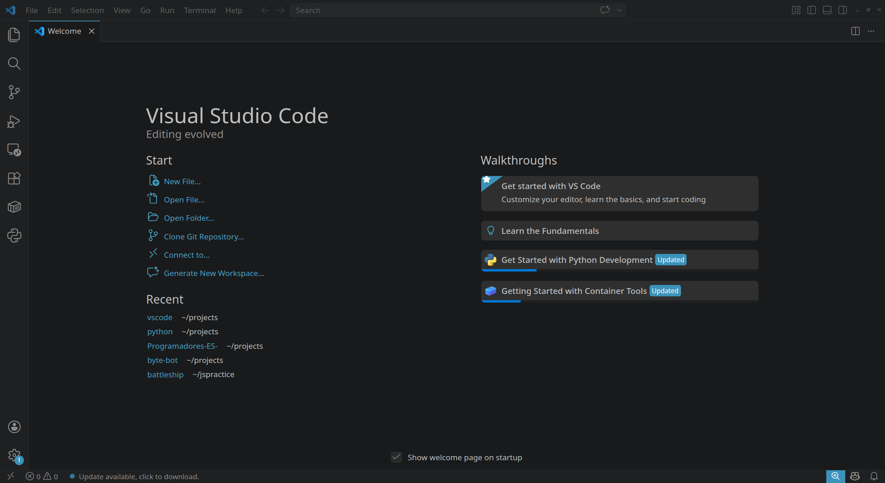

## Before you begin

Make sure you have access to a computer running Windows or Linux.

import OSInstaller from "../../../components/OSInstaller.astro";

<OSInstaller />

## Opening VS Code for the first time

When you launch BVS Code for the first time you may see a Welcome or Get Started screen.

> A quick note about the interface
> You may notices that VSCode has several panels and buttons. Do not worry about learning then all at once
> We will explote the interface in the next unit.

## Creating or opening a project folder

Before writing code, you need a place to store your work.
You can open a folder via menu `File -> Open folder...` and selecting your folder you want to open.

A project folder is related with its own workspace, a workspace is a collection of one or more project folder opened in a single VS Code window.

**Some key features of a workspace**

- Saved state: VS Code remembers you open file, editor layout and enabled or diabled extensions.
- Unified Search and Debugging: You can search, run tasks and manage debugger launc configuration across all folders in the workspace at the same time.

## Take aways

* **VS Code is a code editor**, not a programming language.
* Some languages require separate software to execute your programs.
* You can use the same editor for different programming languages.
* A project folder helps keep related files organized.
* Opening a folder in VS Code establishes your working context.