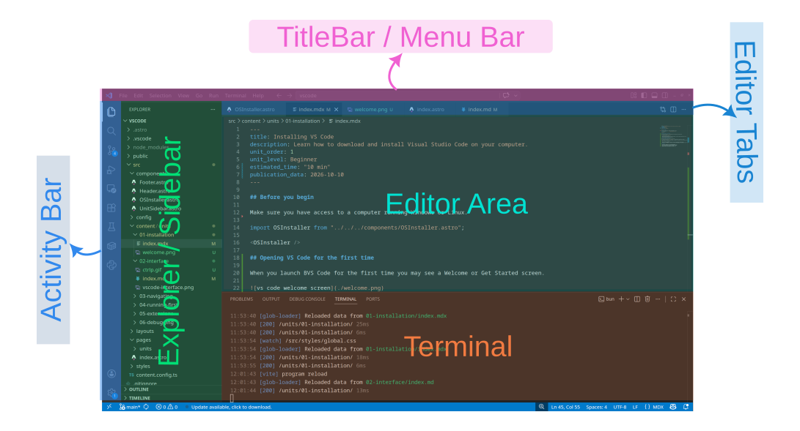
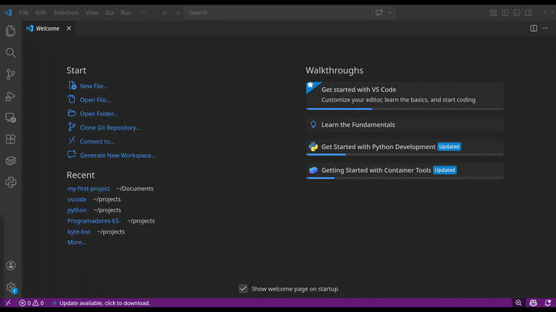
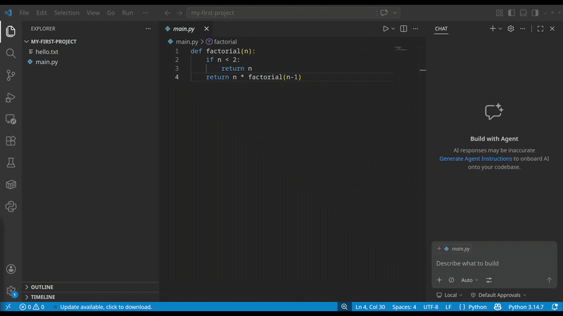
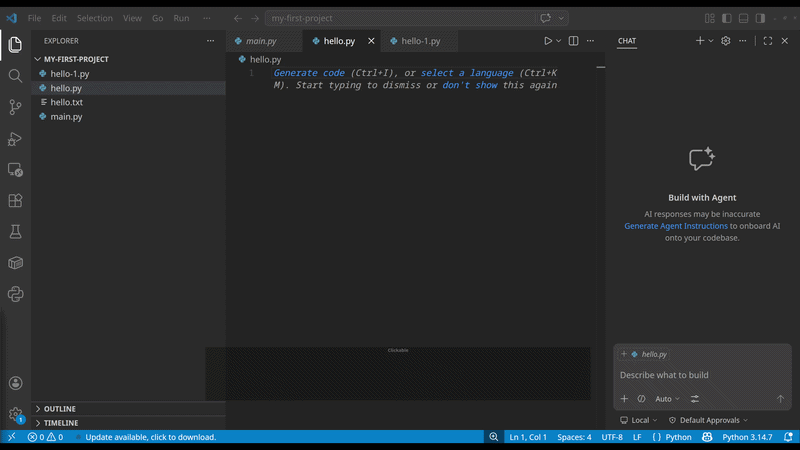
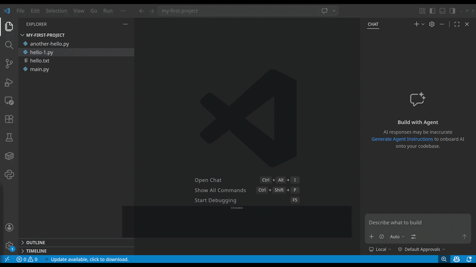
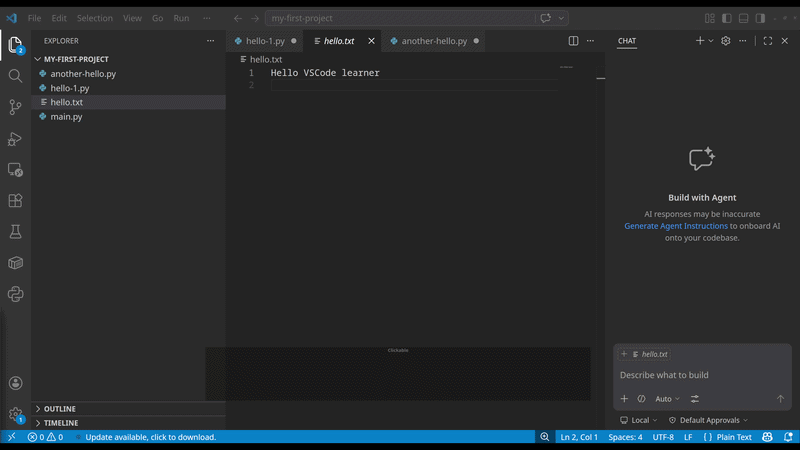

import PracticeActivity from "../../../components/PracticeActivity.astro";

When you open a project in VS Code, you'll see several areas arranged around the editor.

The exact appearance may vary depending on your operating system, theme, and settings, but the main areas are generally the same.

Following we going to explain what are the main sections of the vscode interface

### Activity Bar

The activity bar is normally located on the left side of the window and contains icons to switch between different views such as Explorer, Search, Run and Debug, and Extensions.

### Explorer / Sidebar

This area displays the view you have selected in the activity bar. For example, when you select the Explorer, the sidebar will show your project's files and folders.

### Editor

The central part of the interface is the Editor, where you open and modify files. When you open a Python file, for instance, its contents will appear here. 
You can have multiple files open at the same time.

### Terminal

This section is located near the bottom of the interface and contains various tools such as the integrated terminal, Problems, Output, and Debug Console. 
If you cannot see it, you can open it via the menu bar (Terminal -> New Terminal or View -> Terminal).

### Menu Bar

The menu bar at the top of the interface provides access to commands such as File, Edit, Selection, View, Go, Run, Terminal, and Help.

## Working with the editor

VS Code is designed to be intuitive. When you hover over a button or something clickable, the cursor shape will change. 
The same happens when you hover over a division line between areas or panels; you can click on it to adjust window sizes.

> If you accidentally hide a panel or change the layout, use the View option in the menu bar to locate relevant controls.

### Exploring the explorer

One of the most important parts of VS Code is the Explorer, which helps you navigate your project. 
Let's perform some operations with the Explorer.

After opening a folder we can open files directly from the Explorer

**Opening a file in the explorer**

1. Ensure that the Explorer is selected in the Activity bar and an opened project folder is visible.
2. Locate the file you want to open.
3. Click on the filename to open it. The content will appear in the Editor.

**Creating a new file**

1. In the Explorer, select the folder where you want to create the file.
2.  Select the New File icon, or right-click the folder and choose New File.
3. Enter a filename, such as `hello.py`.
4. Press Enter.

The new file will appear in the Explorer and open in the Editor.

**Renaming files**

1. Right-click the file.
2. Select Rename.
3. Enter the new name and press Enter.

**Deleting files**

1. Right-click the file.
2. Select Delete.
3. Confirm the action if prompted.

Be careful when deleting files; depending on your operating system and configuration, 
deletion may move the file to a trash location or remove it permanently.

### Working with the editor and tabs

The Editor is where you spend most of your time writing and reading code. 
When you open a file, VS Code displays it in an editor tab, making it easy to switch between files without repeatedly searching for them.

**Opening and switching between tabs**

1. Open a file from the Explorer.
2. Open another file.
3. Notice that both files appear as tabs above the Editor.
4. Select a tab to switch between the open files.

You can split the editor to have multiple editors at once:

Right-click an editor tab and select "Split Editor" or click the icon resembling □□ (two squares).
The editor will split into two parts, allowing you to view the same file in both or different files side by side.
To close a split editor, simply close all tabs within it.

**Saving a files**

After modifying a file, you need to save your changes.

Windows/Linux: Ctrl + S

You can also select `File -> Save` from the menu.
Depending on your settings, unsaved changes may be indicated by a dot on the editor tab.

Sometimes you might want to save a file multiple times to avoid data loss. To enable Auto-save mode:

1. Go to the menu bar and select File -> Autosave.

### About the terminal panel

A terminal (or command-line interface) is a text-based user interface that lets you communicate directly with your computer's 
operating system by typing commands instead of clicking buttons and icons.

For Windows, common terminals include CMD and PowerShell. On Linux, you might see terminals like bash or zsh. 
Even though many terminals share a common origin, they do not always use the same commands for communication. VS Code allows you to open any installed terminal on your computer. If you want to use a different terminal:

1. Click the v caret sign next to the + button at the top right of the terminal panel.
2. Select the desired terminal.

> Tip: For Windows users, we encourage trying WSL Ubuntu. 
> This provides a native Linux environment within Windows with access to popular development tools like 
> Python, Node.js/npm, Docker, databases (PostgreSQL, Redis), compilers (GCC, Clang), 
> and utilities like tmux or htop.

<PracticeActivity
  description="Let's explore the interface using your my-first-project folder from Unit 1."
  tasks={[
    "Open your project folder in VS Code.",
    "Locate the Activity Bar, Side Bar, Editor, Panel, and Status Bar.",
    "Create a file named hello.py.",
    "Open the file and type a short comment, such as # My first VS Code file.",
    "Save the file.",
    "Open another file, then switch back to hello.py using the editor tabs.",
    "Open the integrated terminal.",
  ]}
/>
