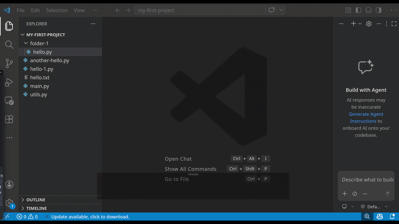
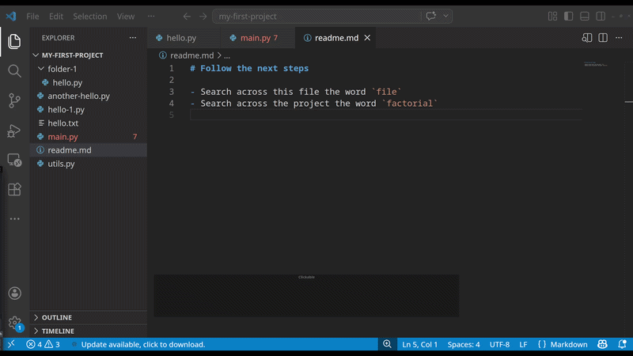
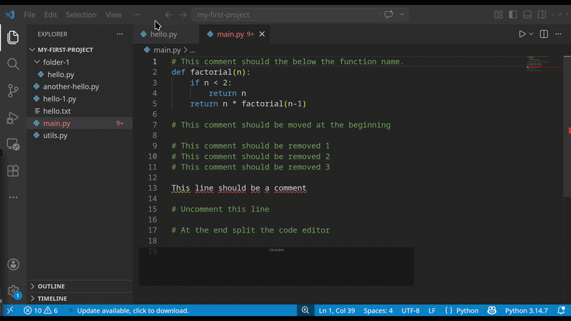

import Table from "../../../components/Table.astro";
import PracticeActivity from "../../../components/PracticeActivity.astro";

VS Code provides several ways to navigate files, search information, and access tools. 
Learning a few keyboard shortcuts can make everyday tasks faster.

The first step is to kwno what shortcut exist, eventually you will adopt it while you work in more projects.

## Undertanding keyboard shortcuts

A shortcut is a combination of keys that performs an action without requiring you to navigate through menus.

### How to read shortcuts

In this unit, shortcuts are written using the following notation:

<Table
  headings={["Notation", "Meaning"]}
  rows={[
    ["Ctrl", "Control key"],
    ["Shift", "Shift key"],
    ["Alt", "Alt key"],
    ["+", "Press the keys together"],
    [",", "Press the first combination, release it then press the next"],
  ]}
/>

For example <kbd>Ctrl</kbd> + <kbd>Shift</kbd> + <kbd>P</kbd> means to hold <kbd>Ctrl</kbd> and <kbd>Shift</kbd>, press <kbd>P</kbd>,
and the release the keys.

Some shortcuts differ between operating systems, keyboard layouts, and customized VS Code settings. 
When in doubt, check the shortcut displayed in the menus or Keyboard Shortcuts editor.

>**Tip:** You don't need to memorize every shortcut. Start with the ones you use frequently.

### How to use Quick Open

1. Press <kbd>Ctrl</kbd> + <kbd>P</kbd>on Windows or Linux.
2. Start typing the name of the file you want to open.
3. Select the matching result.
4. Press Enter.

You don't need to type the complete filename. For example, typing `main` can help you find `main.py`.
Quick Open is especially useful when you already know the name of the file you want to edit.

This feature is particularly helpful in large projects with many files. 
Even if there are multiple files with the same name in different folders, 
VS Code will show you the file location next to the file name, allowing you to differentiate them.

### Search across your project

Quick Open find files by name. But what if you remember a piece of text and do not know which file contains it.
Use **Search** to find text across the file in your open project.

**How to search**

1. Open the Search view using the magnifying glass in the Activity Bar, or press <kbd>Ctrl</kbd> + <kbd>Shift</kbd> + <kbd>F</kbd> on Windows/Linux.
2. Type the word or phrase you're looking for.
3. Review the matching files and lines.
4. Select a result to open the file at the matching location.

You can also search within the currently open file using <kbd>Ctrl</kbd> + <kbd>F</kbd> on Windows/Linux.

### Use the command palette

How to use it

1. Press <kbd>Ctrl</kbd> + <kbd>Shift</kbd> + <kbd>P</kbd> on Windows/Linux.
2. Type the name of an action, such as `Toggle Side Bar Visibility`.
3. Select the command from the list and press Enter.

You can use the Command Palette to perform actions such as:

- Changing the color theme.
- Showing or hiding interface panels.
- Formatting a document.
- Opening settings.
- Managing extensions.
- Changing editor layout.

The available commands depend on the features and extensions installed in your VS Code environment.

>**Tip:** If you know what you want to do but don't know the shortcut, search for the action in the Command Palette.

### Useful keyboard shortcuts

<Table
  headings={["Action", "Shortcut"]}
  rows={[
    ["Quick Open", "Ctrl + P"],
    ["Command Palette", `Ctrl + Shift + P`],
    ["Search in project", "Ctrl + Shift + F"],
    ["Search in the current file", "Ctrl + F"],
    ["Save file", "Ctrl + S"],
    ["Open a new instance of VS Code", "Ctrl + Shift + N"],
    ["Increase the font size of VS Code", "Ctrl + +"],
    ["Decrease the font size of VS Code", "Ctrl + -"],
  ]}
/>

### Aditional shorcuts for editing code

As long as you're coding, editor shortcuts will be very useful. Here are some:

>Note: Many shorcuts acts over the cursor *the blinking line in the editor*

<Table
  headings={["Action", "Shortcut"]}
  rows={[
    ["Move the actual line up/down", "Alt + (up/down)Arrow"],
    ["Remove the actual line", "Ctrl + Shift + K"],
    ["Convert to a comment the actual line", "Ctrl + /"],
    ["Split the editor window", "Ctrl + \\"],
  ]}
/>

> Converting a line to comments could require additional extensions.
> If do not know what si a `extension`, do not worry you will see it in the next unit. 

### How to custom your own key

You don't need to rely on memory. VS Code lets you look up shortcuts and customize them.
To open the Keyboard Shortcuts editor:

1. Open the Command Palette.
2. Search for `Preferences: Open Keyboard Shortcuts`.
3. Find the action you want to use.
4. Review its current keybinding.
  
You can also open the Keyboard Shortcuts editor from the File or Code menus, depending on your operating system and VS Code version.
If a shortcut conflicts with another application or doesn't work with your keyboard layout, you can assign a different combination.

>**Tip:** Before changing a shortcut, check whether it is already assigned to another command.

<PracticeActivity
  description="Use the following tasks to practice navigating a project."
  tasks={[
    "Open your project folder in VS Code.",
    "Use Quick Open to find a file by name.",
    "Use Find to locate a word in the current file.",
    "Use Search to find the same word across the project.",
    "Save a file using a keyboard shortcut.",
    "Open the Keyboard Shortcuts editor and look up one action.",
  ]}
/>

You don't have to complete these tasks from memory. Use the menus or Command Palette whenever you need help.

If you want more shortcuts visit the offical page [VS Code shortcuts](https://code.visualstudio.com/docs/reference/default-keybindings)
