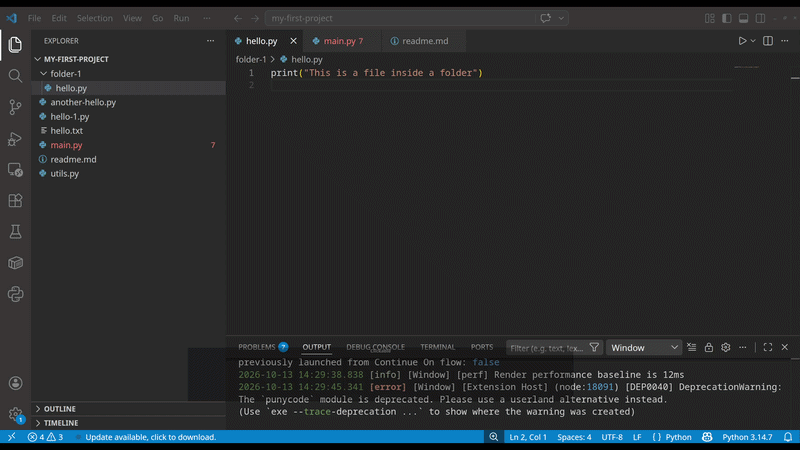

import PracticeActivity from "../../../components/PracticeActivity.astro";

VS Code provides many useful features out of the box, but you can extend its functionality by installing extensions.

Extensions can help you format documents, work with different programming languages, 
check spelling, customize the editor, and much more. You don't need to install many 
extensions to get started. The goal is to find the tools that make your workflow easier.

## What are extensions?

An extension is an add-on that introduces new features or improves existing ones in VS Code.
Think of VS Code as a basic toolkit. Extensions let you add tools depending on what you want to accomplish.
For example, you might install an extension to:

- Get syntax highlighting and language-specific assistance.
- Automatically format your files.
- Check spelling and grammar in documentation.
- Preview Markdown documents.
- Integrate additional development tools.

Extensions are optional. VS Code already includes features such as a file explorer, an integrated terminal, and basic editing tools.

>**Tip**: Start with the features already available in VS Code. Install an extension when you identify a specific need.

## Finding extensions

**How to find an extension**

1. Open the Extensions view using the Extensions icon in the Activity Bar.
2. Enter a name or a keyword in the search field.
3. Review the matching extensions.
4. Select an extension to inspect its description and details.

You can also open the Extensions view using Ctrl + Shift + X.

When evaluating an extension, look for:

Description: Does it provide the functionality you need?
Publisher: Who maintains or publishes it?
Documentation: Are installation instructions and usage examples available?
Updates: Is it maintained and compatible with your VS Code version?
Reviews and usage information: What do other users report? Treat popularity as one signal, not proof of quality or safety.

## Useful extensions to explore

You don't need all of these extensions. Choose the ones that fit your work and the types of files you use.

**Markdown All in One**
Helps with common Markdown editing tasks, such as keyboard shortcuts, lists, and table of contents generation.
Useful if you write documentation, notes, tutorials, or Markdown-based websites.

**markdownlint**
Checks Markdown files for common formatting and consistency issues.
Useful if you want your documentation to follow consistent conventions.
Writing and spelling

**Code Spell Checker**
Helps identify possible spelling mistakes in source files and documentation. It can be particularly useful when writing Markdown or comments.
Spell-checking extensions may flag technical terms, identifiers, or words that are not in their dictionaries.

**Language-specific assistance**
For programming languages such as Python, JavaScript, or C++, language extensions can provide features like code completion, diagnostics, debugging support, and formatting integrations.
Choose an extension that matches the language you're learning, and check whether it requires a separately installed runtime, compiler, or tool.

>Important: Extension availability and features can change. 
>Check the extension's current documentation and requirements before installing it.

## Example: Install a color theme

Let's customize the appearance of VS Code by installing the classic gruvbox theme.

1. Open VS Code's Extensions view with <kbd>Ctrl</kbd> + <kbd>Shift</kbd> + <kbd>X</kbd>.
2. Search for Gruvbox.
3. Verify that the publisher is `jdinhlife` and the extension matches the official listing above.
4. Click Install.
5. Press <kbd>Ctrl</kbd> + <kbd>Shift</kbd> + <kbd>P</kbd> and run Preferences: Color Theme (you can type theme and Preference theme should appear as a choice).
6. Select your preferred Gruvbox variant (I'd chose the dark one).

The editor's appearance should change immediately.

Try it: Switch between the light and dark variants, then choose the one you prefer. 
You can always return to your previous theme using the same Color Theme menu.

_Some popular themes are: zenbones, and Catpuchin, give it a try. Just do not forget about the security recommendations below_

## Extension security and good practices

Extensions can be powerful because they may run code, inspect project files, or communicate with external services. Installing an extension therefore requires some care.

**Follow these practices:**

- Install extensions from a trusted source, and verify the publisher.
- Read the extension description and documentation before installing it.
- Check whether it needs access to external services, credentials, or other sensitive resources.
- Avoid installing extensions simply because they are popular or appear in a recommendation list.
- Keep extensions updated when appropriate, and remove those you no longer use.
- Be cautious when opening unfamiliar projects, especially if an extension asks you to run commands or execute code.
- The Marketplace listing and its publisher information are useful starting points, but they do not guarantee that an extension is safe.

## A little info about your practice Activity

Markdown is a document type that is so popular in code development because it is used in documentation. 
Whenever you see a file with the extension `.md`, you can be sure that it is a Markdown file. 
It is expected for every code project to have a `README.md`. This file is used to explain about the project. 
You can check its rules for writing Markdown docs in this guide [Markdown Guide](https://www.markdownguide.org/basic-syntax/).

<PracticeActivity
  description="Let's customize VS Code for writing Markdown documentation."
  tasks={[
    "Open the Extensions view.",
    "Search for Markdown All in One.",
    "Review its description and publisher.",
    "Install it if it fits your needs.",
    "Open a Markdown file and try one of its features.",
    "Find the extension in the installed extensions list.",
    "If you don't want to install an extension, you can complete the first three tasks just by exploring its Marketplace listing.",
  ]}
/>
