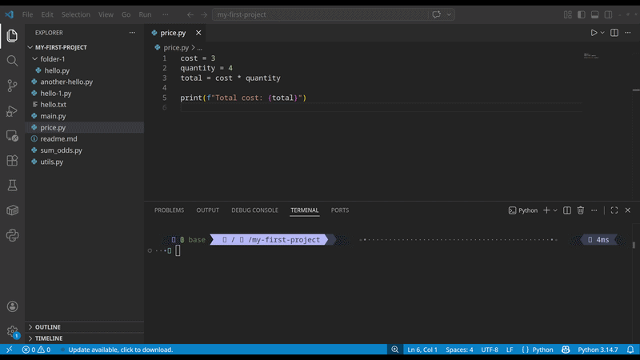
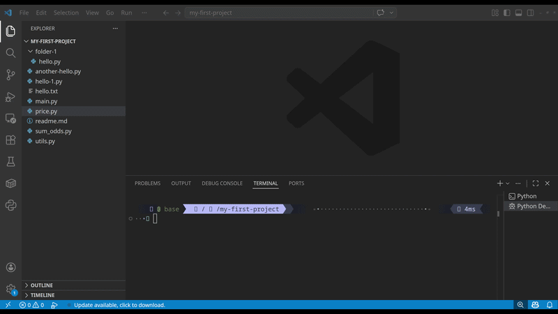

import PracticeActivity from "../../../components/PracticeActivity.astro";

Writing code is only part of the process. You also need to run it, 
observe what happens, and investigate problems when the results are not what you expected.

## Editing code versus running a program

When you write code in VS Code, you're editing a file. Saving that file doesn't automatically execute the instructions it contains.
To run a program, your computer needs the appropriate language runtime or compiler. For example, Python requires a Python interpreter, while JavaScript can run in environments such as Node.js.
VS Code helps you work with these tools, but installing VS Code alone doesn't necessarily install every language or runtime you might need.

A typical workflow looks like this:

- Write or modify your code.
- Save the file.
- Run the program.
- Observe the output or error messages.
- Make changes and run it again.

## Run your first program

For **this example**, we'll use Python. If you don't **have Python installed**, follow the official [Python installation instructions](https://www.python.org/downloads/) for your operating system.

You'll also need the Microsoft **Python extension in VS Code** (Install the one that belong to Microsoft and is verified).

### Create a python file

1. Open your project folder in VS Code.
2. Create a file named price.py.
3. Add the following code:

```python
cost = 3
quantity = 4
total = cost * quantity

print(f"Total cost: {total}")

```

4. Save the file.

### Run the program



**Option A: Use the integrated terminal**

1. Open the terminal using Terminal -> New Terminal.
2. Enter the following command:

```bash
python price.py
```

On some systems, including many linux distro, you may need to use

```bash
python3 price.py
```

The result should be showed in the terminal:

```bash
Total cost: 12
```

**Option B: Use the Run buttom**

1. Make sure you opened the file `price.py`.
2. Select the Run Python File button in the upper-right corner of the editor.
3. Look at the integrated terminal to see the output.

## Understanding program output and errors

When you run a program, you might see the expected result, an error message, or no visible output at all.
An error doesn't necessarily mean that something is wrong with VS Code. The problem might be in your code, 
your environment, or the way you launched the program.

Let us to create an error on purpose. Check the following piece of code:

```python
print("Hello, world"
```
Executing the code, you will see an error in the execution in the terminal.
The closing parenthesis is missing. Python reports a syntax error because the instruction isn't complete.

Common categories of errors include:

- **Syntax errors**: The code doesn't follow the language's rules.
- **Runtime errors**: The program encounters a problem while executing, such as trying to access a file that doesn't exist.
- **Logic errors**: The program runs, but produces an incorrect result.

**A simple troubleshooting checklist**

- Read the error message.
- Check the file and line mentioned in the message.
- Look for missing punctuation, misspelled names, or incorrect values.
- Correct the problem and run the program again.

Don't worry if an error message looks unfamiliar. Learning to interpret errors is a normal part of working with code.
As always you can search the error in google or some familar search engine, It is very possible the many have encounter the same error you have.
Or use AI tool to get some help.

## What is debugging?

Why `debugging` and `bug` are even a technical terms in computer science, there is a interesting story about that, 
you can read more about in this article [The Origins of 'Bug' and "Debugging"...](https://summergeometry.org/sgi2024/the-origins-of-bug-and-debugging-in-computing-and-engineering/) 

Debugging is the process of investigating a program to understand why it behaves unexpectedly and to identify the cause of a problem.
A debugger lets you pause execution and inspect the program while it runs. This can be much more useful than guessing what happened.
VS Code provides debugging tools, but the available functionality depends on the programming language and its debugger extension.

**Set your first breakpoint**

A breakpoint is a marker that tells the debugger to pause when execution reaches a particular line of code.
Let us use the same piece of code from the beginning.

```python
cost = 3
quantity = 4
total = cost * quantity

print(f"Total cost: {total}")

```

**Start a debugging session**



1. Open the Python file.
2. Click in the editor margin to the left of the line numbers, next to total = cost * quantity.
3. A red dot should appear. This is your breakpoint.
4. Open the Run and Debug view.
5. Start debugging the Python file. If prompted, select the appropriate Python debugger.

When execution reaches the breakpoint, the program pauses before executing that line.
You can now inspect the values of price and quantity in the Variables section.

**Step through the program**

While the program is paused, the debug toolbar provides several useful actions:

**Continue**: Resume execution until the next breakpoint or until the program finishes.
**Step Over**: Execute the current line and move to the next one.
**Step Into**: Enter a function call to inspect its execution.
**Stop**: End the debugging session.

For now, focus on Continue and Step Over. The other controls will become more useful as you work with larger programs.
You can also inspect variables by hovering over them in the editor when the debugger is paused.

A common steps for debugging are, check the data flux, check the values of the variable over the time, using `print(..)` 
in python is good to check values when you are beginner, but it is better to use specialized debuggers or logs.

## Practice Activity

Create a file named `sum_odds.py`

```python
# Create a list
lst = [1, 3, 6, 5, 4]
sum = 0
for number in lst:
    if number%2 != 0:
        sum += number

print(sum) 

# expected result
# 9
```

<PracticeActivity
  description="Use the code above to use the debugger"
  tasks={[
    "Run the program and check the output.",
    "Change one of the numbers and run it again.",
    "Set a breakpoint on the line that calculates result.",
    "Start debugging and inspect the values of both numbers.",
    "Use Step Over to execute the calculation.",
    "Continue execution and observe the final output.",
  ]}
/>

>Think about this question: How does inspecting the variables help you understand what the program is doing?
